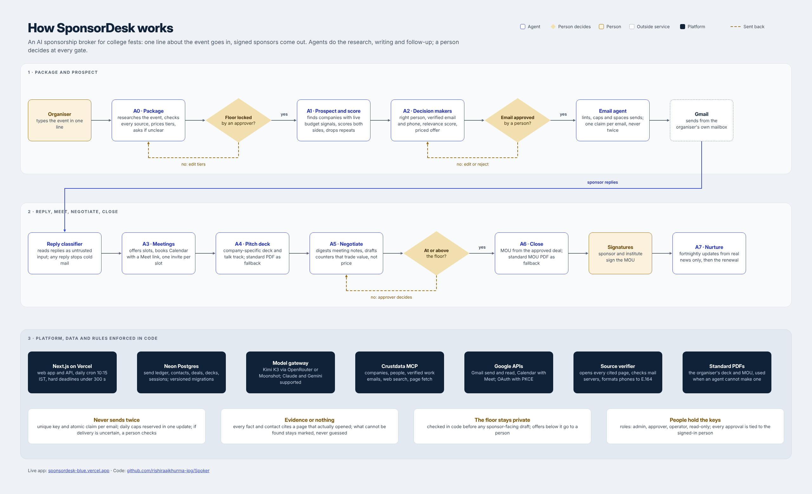

# SponsorDesk

Sponsorship brokerage agents for college fests and events: find sponsors with live budget signals, write priced offers, follow up without ever double-sending, classify replies, negotiate inside the floor, draft the MOU. Humans only for exceptions. Every decision cites its reasons.

Model: any OpenAI-compatible endpoint through `KIMI_K3` (an OpenRouter `sk-or-` key or a Moonshot key; default model Kimi K3) or `OPENROUTER_API_KEY`; Anthropic (`ANTHROPIC_API_KEY`) and Gemini (`GEMINI_API_KEY`) also work. Crustdata (`CRUSTDATA_API_KEY`) supplies company and people data.

## How it is built

## Links

| | |
|---|---|
| Live app | https://sponsordesk-blue.vercel.app/ |
| Sample sponsor deck (Cult.fit x Aavhan) | https://sponsordesk-blue.vercel.app/d/5fa28c2a505a45ff8957 |
| Demo walkthrough (Loom) | https://www.loom.com/share/4ec4186105f14dc88216a162973b5b2a |
| Sample MOU drafted by A6 (Zepto x E-Summit 2027, unsigned draft) | [docs/sample-mou-zepto-esummit-draft.pdf](docs/sample-mou-zepto-esummit-draft.pdf) |
| Architecture diagram (image) | [docs/sponsordesk-architecture.png](docs/sponsordesk-architecture.png) |
| Second walkthrough (Loom) | https://www.loom.com/share/22be30b955e94dc7b3f8815d8f7cefee |
| User interviews (4 fest sponsorship leads) | [research/interviews](research/interviews/README.md) |
| Standard deck and MOU used when the agent cannot produce one | [public/fallback](public/fallback) |

## What it does

| Stage | Agent | In this app |
|---|---|---|
| Package | A0 | Brief tab: audience facts with sources, tiers, floor price, in-kind needs, signature |
| Prospect | A1 | Board > Find sponsors: Claude searches Crustdata for funding, headcount growth, hiring, new leaders |
| Score | A1 | Dual point of view: our view x the company marketing team's view; priority = the lower of the two; every score shows its signals |
| Decision makers | A2 | Primary, alternative and fallback contact per company, picked by relevance (not seniority); professional email and business phone from public sources or Crustdata; each checked (syntax, domain, MX, published on the cited page; E.164, switchboard vs direct) and scored out of 100 with the breakdown |
| Pitch | A2 | First email is a priced offer (activation, price range, metric, reply "send"), never a meeting request |
| Follow up | A2 | Max 3 emails, one thread per company, auto follow-ups only while nobody replied |
| Replies | A2 | Gmail sweep, isolated classifier (sponsor email is untrusted input), cold mail stops for the whole company |
| Negotiate | A5 | Below-floor offers become exceptions with a trade-value counter for a human to approve |
| Close | A6 | MOU draft from the deal sheet |

## Safety rules enforced in code (`lib/ledger.ts`)

- Every email passes the linter (no em/en dashes, no placeholders, signature, postal address, opt-out on cold mail) before it can be queued.
- Only a signed-in user with the approver or admin role can approve; the approver is taken from the session, never from the request. The agent can only auto-approve follow-ups to companies that never replied.
- A unique key per email plus an atomic claim. If Gmail may have sent a message but we could not confirm it (timeout, 5xx, database error after sending), it becomes `send_unknown`, is checked against Gmail Sent, and goes to a person after 6 hours. It is never resent automatically. Exactly-once delivery through an external mail provider cannot be guaranteed; this design prefers a possibly-missed email that a human resolves over a duplicate.
- Daily caps and spacing are reserved with one conditional UPDATE, so concurrent workers cannot exceed them; suppression list for opt-outs and bounces; erasure redacts the person from contacts, emails, replies, meeting notes, decks, logs, exceptions and MOUs (DPDP).
- Out-of-office pauses a sequence instead of killing it; a reply on a live deal never resets its stage.
- Cold emails are held until the organisers' written permission is recorded in Settings.

## Accounts and security

Sign in with email and password. On a new desk the first sign-in with `APP_PASSWORD` creates the admin; the admin adds people in Settings with a role: admin, approver, operator or read-only. Sessions are random tokens stored hashed, expire after 7 days, and can be revoked. Logins are rate limited. Every write must come from the app's own origin. Google OAuth uses a one-time state bound to the session plus PKCE; the refresh token is stored encrypted (`TOKEN_KEY`, else `APP_PASSWORD`). `GET /api/cycle` only runs for Vercel Cron with `CRON_SECRET`.

## Tests

Node 22.5 or newer (`.nvmrc`). `npm run test:all` runs the ledger, email-engine failure, security and decision-maker, and end-to-end agent tests, with the model, Gmail and DNS mocked and `node:sqlite` standing in for Postgres. These prove the logic; row locking itself is Postgres behaviour and is not exercised by SQLite. CI runs typecheck, tests and build on every push and pull request.

## Deploy on Vercel

1. Import this repo in Vercel.
2. Storage > Create Database > Neon (free). This adds `DATABASE_URL`.
3. Environment variables: `APP_PASSWORD`, `KIMI_K3` (or `OPENROUTER_API_KEY` / `ANTHROPIC_API_KEY` / `GEMINI_API_KEY`), `CRUSTDATA_API_KEY`, `CRON_SECRET`, optional `TOKEN_KEY`, and for Gmail `GOOGLE_CLIENT_ID`, `GOOGLE_CLIENT_SECRET`.
4. Redeploy. Sign in with your email and `APP_PASSWORD` (this creates the admin), add your team in Settings, then type the event in one line.

### Gmail (optional, otherwise draft mode)
Google Cloud Console > APIs & Services: enable the Gmail API, OAuth consent screen (External, Testing, add your Gmail as a test user), Credentials > OAuth client ID > Web application, authorised redirect URI `https://<your-app>.vercel.app/api/google/callback`. Put the client id and secret in Vercel, redeploy, then Settings > Connect Google (admin).

The daily cycle runs on weekdays at 10:15 IST (Vercel cron) and from the "Run daily cycle" button.

## Skill pack

`skills/` holds the full SponsorDesk skill pack (orchestrator, email agent, A0 to A7, council reviewer, demo mode) for use directly in Claude, plus vendored MIT skills from samber/dev-event-organizer-skills and coreyhaines31/marketingskills.

## Honest limits

- Contacts and signals are only as good as Crustdata's coverage; the app never invents an email, and unverified emails raise an exception.
- When the deck or MOU agent cannot produce a document, the organiser's standard PDFs in `public/fallback/` are used.
- The MOU is a draft for the institute's office, not legal advice. GST and TDS treatment must be confirmed by the accounts office.
